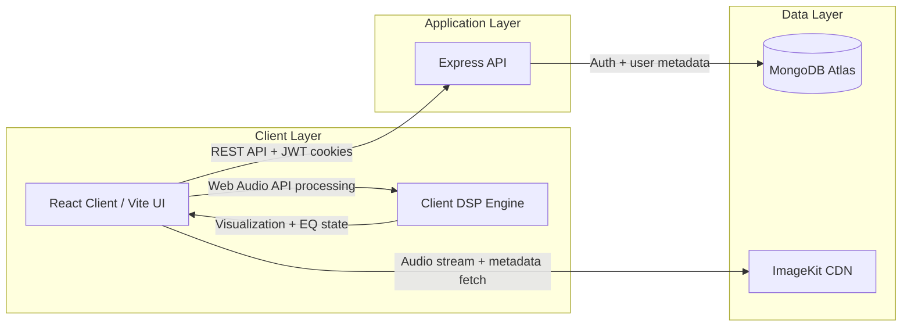

# ResoWave

<p align="center">
  
</p>

<p align="center">
  <strong>High-Fidelity Cloud Audio Streaming Platform & Digital Audio Workstation Lite</strong>
</p>

<p align="center">
  <a href="https://resowave-demo.vercel.app"></a>
  
  
  
  
  
  
  
  
</p>

<p align="center">
  <strong>Demo Link:</strong> <a href="https://resowave-one.vercel.app">https://resowave-demo.vercel.app</a><br />
  <strong>API Base URL:</strong> <code>https://api.resowave.app</code><br />
  <strong>UI Screen Mockup / GIF:</strong> <a href="https://placehold.co/1400x800/121212/1DB954?text=ResoWave+UI+Preview">Preview</a>
</p>

ResoWave is a production-oriented cloud audio streaming platform designed for high-fidelity music playback, artist publishing workflows, and polished user experience across desktop and mobile browsers. Built on the MERN stack and paired with ImageKit CDN, it blends a Spotify-inspired interface with a lightweight digital audio workstation feel, all while optimizing for low-latency media delivery, real-time client-side DSP, and secure access control.

The project is engineered not just as a demo app, but as a showcase of thoughtful systems design: a singleton playback engine, performant client-side audio routing, secure JWT-based auth, cloud asset orchestration, and media-first UX patterns that feel native without ever leaving the browser.

---

## Why ResoWave

ResoWave addresses a familiar software challenge: streaming media in a browser without compromising responsiveness, ownership, or developer ergonomics. Instead of treating audio as a simple `<audio>` tag bolted onto a UI, the application treats playback, state orchestration, and metadata handling as a first-class system.

Areas of focus include:

- High-quality audio delivery and playback control
- Secure artist vs listener role separation
- Cloud-native asset upload and streaming workflows
- Real-time visual feedback using the Web Audio API
- Searchable, shareable, and SEO-friendly media metadata

This makes the project particularly compelling for recruiters, engineering managers, and contributors looking for evidence of product thinking, systems design, and front-end/backend integration maturity.

---

## Core Features

### 1) Streaming & Audio Engine

- Native HTML5 audio playback wrapped in a singleton architecture for consistent lifecycle management
- Zero-overlap queue semantics to avoid concurrent playback race conditions
- Playback rate control from 0.75x to 2.0x for flexible listening modes
- Continuous playback queue progression with deterministic track transitions
- Shuffle mode using Fisher-Yates ordering and three-way repeat behavior: off / repeat-one / repeat-all
- Track-level state synchronization across the UI, current queue, and user interactions

### 2) Real-Time DSP & Visuals

- 32-bin frequency spectrum visualization using `AnalyserNode`
- 3-band graphic equalizer with bass, mid, treble controls using `BiquadFilterNode`
- Dynamic cover-art palette extraction for immersive UI background tinting and accent generation
- Lightweight visual feedback that responds to both playback state and audio characteristics
- Dark-first Spotify-inspired palette: `#121212`, `#181818`, `#1DB954`

### 3) Synced Karaoke Lyrics

- LRC timestamp parsing with precise active line detection
- Auto-scrolling lyric progression synchronized with playback position
- Click-to-seek support that lets users jump directly to the relevant lyric moment
- Multi-line render logic tuned for readability and low layout churn during playback

### 4) Artist Studio & Upload Pipeline

- Artist authentication and role-gated upload access
- Multipart upload support for audio files with in-memory buffering to reduce unnecessary disk I/O
- Live upload progress monitoring through Axios `onUploadProgress`
- Metadata persistence in MongoDB with storage orchestration through ImageKit CDN
- Clean separation between content upload flow and listener consumption flow

### 5) Hardware & OS Integration

- MediaSession API support for browser-level control surfaces
- Lock screen / notification metadata orchestration for track title, artist, and album art
- Headphone button mapping for play/pause and track skipping when supported by the browser/device
- Focused support for a native-feeling media experience without a native app shell

### 6) SEO & Social Sharing

- Dynamic document titles that reflect currently playing tracks
- Open Graph metadata and Twitter card support for share quality
- `robots.txt` and XML sitemap generation for discoverability
- Social metadata designed to expand reach beyond the app shell itself

---

## System Architecture & Data Flow



This architecture intentionally separates the concerns of metadata management and media delivery:

- The browser remains the primary orchestration layer for playback UX, DSP, and visual state.
- Express handles auth, session validation, and metadata-driven API operations.
- MongoDB stores structured application state such as users, music metadata, and artist content references.
- ImageKit serves the actual audio and cover assets at scale, keeping the streaming path optimized for delivery rather than application logic.

This split is an important architectural decision because it prevents the app from treating audio files as backend-managed blobs when they are better served via a media CDN.

---

## Deep-Dive Engineering Highlights

### Singleton Audio Engine Lifecycle

The audio playback layer is designed as a singleton to ensure a single authoritative playback state across route transitions, component re-renders, and UI state changes. This prevents memory leaks, duplicate audio instances, and race conditions where multiple play promises may attempt to overlap.

Key engineering decisions:

- Reuse a single playback controller instead of allocating a new `audio` element per page render
- Centralize play/pause/seek/scrub logic in one lifecycle owner
- Guard repeated state transitions with clean abort/cleanup paths to minimize `AbortError` scenarios
- Keep UI components declarative while the player state remains controlled by a stable engine instance

### Web Audio API Node Re-use

The sound engine avoids creating redundant `AudioContext` and `MediaElementAudioSourceNode` instances each time a track changes. Reusing those nodes safely is non-trivial because browser APIs enforce strict lifecycle constraints; reattaching a source node or re-initializing an existing context can trigger `InvalidStateError` or inconsistent visual output.

The result is a more stable DSP pipeline:

- One audio graph for analysis and EQ processing
- Deterministic node reuse across track transitions
- Fewer GC pauses and substantially better performance under frequent playback state changes

### Cross-Origin Canvas Tainting & Palette Extraction

Cover-art extraction is intentionally built to handle CDN-hosted media, which often introduces CORS constraints when attempting to draw images into a canvas for color analysis. The solution treats CDN trust and state management as a first-class concern, ensuring that palette extraction does not fail silently when the browser refuses cross-origin access.

This protects the product experience by:

- Keeping fallback color themes stable when CDN restrictions are encountered
- Preserving UI readability even when artwork is unavailable or cross-origin access is restricted
- Maintaining a cohesive visual identity for track cards, player chrome, and backgrounds

### Event Propagation in Interactive Track Rows

On a complex media interface, a single click can trigger multiple behaviors: play, queue, favorite, dropdown, and navigation. Preventing bubbling from nested interactive controls is essential to avoid accidental state mutation and UX confusion.

The design uses controlled click propagation boundaries to ensure that:

- Favorite toggles work independently of row selection
- Dropdown actions do not trigger track playback
- User interactions remain predictable even in dense playlists

This is a subtle but highly visible detail that separates polished interfaces from fragile prototypes.

---

## API Documentation Reference

The application exposes a small but well-scoped API surface focused on auth, user state, and music management.

| Area | Method | Endpoint | Purpose |
| --- | --- | --- | --- |
| Auth | `POST` | `/api/auth/register` | Create a new user account |
| Auth | `POST` | `/api/auth/login` | Authenticate user and issue secure JWT cookie |
| Auth | `GET` | `/api/auth/me` | Return current authenticated user profile |
| Auth | `POST` | `/api/auth/logout` | Clear authentication session and cookie |
| Music | `GET` | `/api/music` | Fetch music catalog and track metadata |
| Music | `POST` | `/api/music/upload` | Upload a new track with metadata and media payload |
| Music | `POST` | `/api/music/create_music` | Create/attach a new music item on the artist side |
| Music | `GET` | `/api/music/liked` | Return user-liked tracks or saved library items |
| Music | `DELETE` | `/api/music/:id` | Remove a track by identifier |
| Music | `GET` | `/api/music/album` | List albums |
| Music | `GET` | `/api/music/album/:id` | Fetch album metadata by ID |

Notes:

- Authentication is handled through HTTP-only cookies for session security.
- Role-based access is enforced across artist-protected write paths.
- The app validates file type and file size before upload to prevent abuse and reduce storage churn.

---

## Keyboard Shortcuts

Global keyboard shortcuts are implemented to support quick player interaction while preventing accidental triggers when users are typing into inputs or text fields.

| Key | Action | Guard Condition |
| --- | --- | --- |
| `Space` | Toggle play/pause | Ignore when focus is inside `<input>`, `<textarea>`, or editable content |
| `ArrowLeft` | Seek backward by a short interval | Ignore during form editing |
| `ArrowRight` | Seek forward by a short interval | Ignore during form editing |
| `M` | Toggle mute/unmute | Guarded against text-entry focus |
| `L` | Toggle lyrics panel | Intended for quick screen-reader and accessibility-focused viewing |
| `Shift + ArrowLeft` | Previous track | Single-step queue navigation |
| `Shift + ArrowRight` | Next track | Single-step queue navigation |
| `S` | Toggle shuffle | Only affects player state while no text input is focused |

This pattern is important because it preserves expected browser behavior while still enabling fast keyboard controls for power users.

---

## Local Setup & Environment Configuration

### Prerequisites

- Node.js `>= 18`
- MongoDB Atlas connection string or local MongoDB instance
- ImageKit account with public/private keys and URL endpoint
- A frontend origin for local development (typically `http://localhost:5173`)

### 1) Clone the repository

```bash
git clone https://github.com/Sahil485661/resowave.git
cd resowave
```

### 2) Install dependencies

```bash
# Frontend
cd client
npm install

# Backend
cd ../server
npm install
```

### 3) Start development servers

```bash
# Terminal 1: frontend
cd client
npm run dev

# Terminal 2: backend
cd server
npm run dev
```

### 4) Frontend environment

Create `client/.env`:

```env
VITE_API_URL=http://localhost:5000
```

### 5) Backend environment

Create `server/.env`:

```env
PORT=5000
MONGO_URI=mongodb+srv://<username>:<password>@cluster.mongodb.net/resowave
JWT_SECRET=replace_with_a_strong_secret_key
IMAGEKIT_PUBLIC_KEY=your_imagekit_public_key
IMAGEKIT_PRIVATE_KEY=your_imagekit_private_key
IMAGEKIT_URL_ENDPOINT=https://ik.imagekit.io/your_imagekit_id
CLIENT_URL=http://localhost:5173
```

### 6) Production notes

- Use HTTPS-enabled origins in production to ensure cookies are transmitted securely.
- Configure allowed frontend origins in the server CORS layer.
- Keep secrets out of source control and inject them via your deployment environment manager.

---

## Folder Structure

```text
resowave/
├── client/
│   ├── public/
│   ├── src/
│   │   ├── api/
│   │   ├── assets/
│   │   ├── components/
│   │   ├── context/
│   │   ├── hooks/
│   │   ├── lib/
│   │   ├── pages/
│   │   ├── App.jsx
│   │   ├── index.css
│   │   ├── main.jsx
│   │   └── ...
│   ├── index.html
│   ├── package.json
│   ├── tailwind.config.js
│   ├── vite.config.js
│   └── vercel.json
├── server/
│   ├── src/
│   │   ├── controller/
│   │   ├── database/
│   │   ├── middlewares/
│   │   ├── model/
│   │   ├── routes/
│   │   ├── service/
│   │   ├── app.js
│   │   └── ...
│   ├── server.js
│   ├── package.json
│   └── ...
├── render.yaml
├── vercel.json
├── .gitignore
└── README.md
```

This directory organization reflects a deliberate separation of concerns:

- `client/src` owns the UX layer, state orchestration, and playback responsibilities
- `server/src/routes` exposes API contracts
- `server/src/controller` handles request orchestration
- `server/src/service` centralizes business logic, external integrations, and domain actions
- `server/src/model` defines persistence schema and data contracts

---

## Production Engineering Profile

ResoWave is designed to communicate an engineering profile that extends beyond "basic CRUD with audio playback." It combines interface craft with systems thinking:

- Secure auth flows with cookie-based session handling
- Media-first delivery via CDN-backed asset distribution
- Real-time browser DSP without overloading the main thread
- Thoughtful state management for a playback-heavy application
- An architecture that supports scaling from local development into production deployment environments

That combination is what makes the project both interesting to users and credible to technical stakeholders.

---

## Contributing

Contributions are welcome for areas such as:

- Improved queue management and state persistence
- Better audio metadata normalization
- Enhanced lyric parsing for broader LRC compatibility
- More robust upload validation and retry logic
- Additional accessibility and keyboard UX polish

If you want to collaborate, start by opening a feature discussion, then propose a focused implementation plan with testing and performance implications clearly documented.

---

## License

This project is distributed as a portfolio/engineering showcase and does not currently declare a formal repository license. If you plan to use or extend it commercially, confirm licensing status before production deployment.

---

<p align="center">
  <em>Built for listening, built for scale, built to be remembered.</em>
</p>
